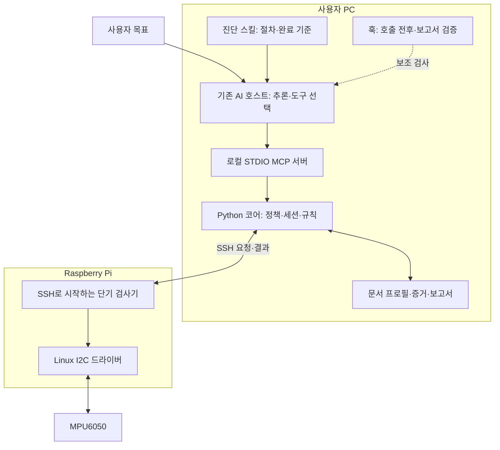

# EmbedSleuth 아키텍처

기준일: 2026-11-25. 기존 AI 호스트·스킬·훅·MCP와 PC/Pi 실행 분리를 확정 아키텍처로 사용한다. Phase별 구현 여부는 [구현 계획](implementation-plan.md)을 따른다.

v0.1.0 배포의 구조와 기록은 아래에 보존한다. 2026-11-27 v0.2.0은 기존 프로젝트의 보존 병합과 별도 `sensor_check` 모드의 로컬 승인·샘플링·SLEEP 복원을 추가한다. 기본 read_only/passive는 그대로다. 새 도구 두 개를 포함해 v0.2.0 MCP 도구는 11개이며 승인 자체는 MCP에 없다. [확장 설계](v0.2.0-plan.md)와 [사용·승인·실패 경계](v0.2.0-usage.md)가 추가 범위의 규격이다. 실제 Pi의 센서 깨우기·수집·절전 복원 인수는 v0.2.0 검증 기록을 따른다.

## 1. 배치

AI 호스트가 모델 호출·추론 반복을 담당한다. EmbedSleuth는 자체 LLM 호출을 하지 않는다. MCP는 인터페이스이며, 결정적인 검사는 Python 구현의 성질이다. [MCP 아키텍처](https://modelcontextprotocol.io/docs/learn/architecture)

첫 통합 검증은 로컬 Codex CLI·Linux PC에서 수행한다. MCP는 STDIO로 시작하고 네트워크 수신 포트를 열지 않는다. stdout은 프로토콜 전용, 로그는 stderr다. 호스트의 MCP 지원과 스킬·훅 지원은 별도로 검증한다. [공식 OpenAI MCP 문서](https://learn.chatgpt.com/docs/extend/mcp)

Pi는 기존 SSH 서버·I2C 드라이버·기존 검사 명령과 최소 Python 검사기만 사용한다. 모델·MCP 서버·상주 데몬·PC 패키지를 배포하지 않는다. 장치 파일 접근은 Pi에서 실행한다. [Linux I2C 사용자 공간 인터페이스](https://www.kernel.org/doc/html/latest/i2c/dev-interface.html)

## 2. 책임과 신뢰 경계

| 계층 | 책임 | 권한 경계 |
|---|---|---|
| AI | 목표 해석·원인 후보·다음 검사·설명 | 관측 생성·실행 정책 우회 권한 없음 |
| 스킬 | 검사 순서·분기·완료 조건 | 절차 지시이며 접근 통제 대체 불가 |
| 훅 | 호출 사전 검사·기록 확인·보고서 형식 검증 | 유일한 안전 경계로 사용 금지 |
| MCP 어댑터 | 입력 검증·코어 호출·구조화 결과 | 임의 명령·키 경로·호스트 인자 금지 |
| 코어 | 세션·예산·정책·규칙·증거 관리 | 선행 조건 미충족·불명확 시 차단 |
| SSH·검사기 | 고정 검사만 실행·출력과 수명 제한 | 원격 설치·자동 sudo 금지 |

등록 대상 ID는 PC가 관리하는 SSH 연결 참조와 예상 하드웨어 구성을 가리킨다. 동일한 정규화 호스트·포트는 다른 ID·계정·버스로 중복 등록할 수 없다. 물리 장치당 안정된 대상 ID와 하나의 공유 저장소를 유지해야 한다. 다른 DNS/IP 별칭·SSH 터널·서로 다른 저장소가 같은 장치를 가리키는지 자동 판별하지는 않는다. AI가 호스트·계정·키 경로를 변경할 수 없다. 사용자 선언, 문서 근거, 원격 관측을 구분한다. 일반 셸 등 MCP 밖의 경로까지 서버 정책이 자동 통제하는 것은 아니므로 강제 격리가 필요하면 호스트·SSH 계정 권한도 별도로 제한한다.

## 3. 스킬과 훅

Phase 4의 diagnose-mpu6050는 대상 확인 → 환경 조사 → I2C 조사 → 조건부 식별 읽기 → 규칙 평가 → 근거 있는 보고서 순서를 정의한다. 배포 원본은 src/embedsleuth/data/skills/diagnose-mpu6050이며 skills/diagnose-mpu6050 별칭과 .agents/skills의 저장소 내부 상대 링크로 검색한다. agents/openai.yaml에 embedsleuth STDIO MCP 의존성과 자동 선택 허용을 선언한다. 명시 호출부터 평가하는 순서와 자동 선택 허용 정책은 별개다. [공식 OpenAI 스킬 문서](https://learn.chatgpt.com/docs/build-skills)

스킬은 누락 대상·주소·현재 충돌 배제 확인, passive 범위, 실제 도구 스키마·응답 봉투, 오류·취소 시 중단, 출처 참조와 보고 한계를 안내한다. 범용 셸로 검사를 대체하거나 모델이 관측·승인을 생성하지 않는다. 로컬 등록의 운영 선언은 질문 답변만으로 바뀌지 않는다. 코어 코드를 호출하는 별도 LLM 루프·진단용 스크립트는 스킬에 포함하지 않는다.

평가 자료의 검토된 20개 절차를 실제 MCP·코어와 가짜 전송으로 재생한다. 별도의 개발용 Codex 확인기는 임시 설정·빈 대상 목록에서 skills/list와 mcpServerStatus/list를 읽어 검색·의존성·아홉 입력 스키마를 확인한다. 모델 turn·운영 대상 설정을 생성하지 않는다. 자연어 선택·절차 준수·원인 설명 품질은 이 시험으로 입증되지 않으며 Phase 6 모델 행동 평가에 남긴다. [스킬 운영 안내](skill-usage.md), [평가 자료](../evals/diagnose-mpu6050/README.md)

| 훅 | 수행할 일 | 수행하지 않을 일 |
|---|---|---|
| PreToolUse | 활성 실행·도구·인자 범위 추가 검사 | 실제 관측 대신 허용 플래그 생성 |
| PostToolUse | 코어의 실행·증거 기록 누락 확인 | 동일 하드웨어 검사 재실행·소급 승인 |
| Stop | 보고서 구조·참조·미확인 사항 확인 | 원인 확정 강요·무제한 재검사 |

훅 오류·시간 초과·미지원 환경에서도 코어는 동일한 제한을 적용한다. 종료 검사는 활성 EmbedSleuth 실행에 한정하며 부분 완료를 인정한다. 자연어 주장의 진실성까지 구조 검사로 보장하지 않는다. [공식 OpenAI 훅 문서](https://learn.chatgpt.com/docs/hooks)

Phase 5의 hooks.py는 PC의 짧은 Python 명령으로 이 검사를 수행한다. PreToolUse는 중립 응답 또는 거부만 반환하고 승인 허용·인자 변경을 하지 않는다. PostToolUse는 실제 MCP 봉투와 영속 증거·감사를 비교하며 불일치는 원래 결과를 보존한 경고로 처리한다. Stop은 session_id/turn_id로 분리한 전용 기록의 활성 실행만 검사한다. 유효한 부분·중단 보고서를 허용하며 보완 요청은 턴당 한 번이다. 호스트가 stop_hook_active를 전달하면 첫 호출이어도 다시 block하지 않는다.

진단 저장소는 RunStore.open_reader로 열어 생성·복구·잠금을 수행하지 않는다. 훅의 호출 해시·run_id·완료 여부·종료 보완 여부는 별도의 소유자 전용 저장소에 둔다. 두 루트는 서로 포함될 수 없다. 입력의 cwd·transcript_path를 읽지 않으며 관측·응답·대화록을 복제하지 않는다. 훅은 코어 호출·원격 작업을 시작하지 않는다. 동시 기록·취소로 일치 여부가 모호하면 경고한다. 설정 생성기는 검토할 정의만 출력하며 호스트 신뢰를 부여하지 않는다. [훅 운영 안내](hooks-usage.md)

## 4. 계약과 실행 상태

Phase 1 계약은 src/embedsleuth/contracts.py와 tools.py에 있다. 모든 모델은 미등록 필드를 거부하고 숫자·불리언을 암묵 변환하지 않는다. JSON 경계에서는 날짜·배열의 wire 표현을 허용한다. 식별 요청은 승인·현재 권한·점유 상태를 받지 않으며 이러한 상태는 코어가 관측한다.

| 도구 | 인자 |
|---|---|
| get_component_profile | profile_id |
| start_diagnosis | target_id, profile_id, mode(read_only 기본) |
| inspect_target | run_id |
| inspect_i2c_environment | run_id |
| read_device_identity | run_id, bus_ref, address, operation_id |
| evaluate_findings | run_id |
| finalize_report | run_id, 선택적 hypotheses |
| get_report | run_id |
| cancel_diagnosis | run_id |

Phase 2는 위 도구의 결정적 코어 실행과 대상 등록을 Python API로 구현했고 Phase 3는 같은 입력 스키마와 코어를 STDIO MCP로 노출한다. address는 wire 계약에서 비예약 7비트 범위를 검증하고, 코어 정책에서 부품과 예상 연결의 교집합으로 다시 제한한다. 레지스터·길이·전송 방식은 프로필로만 정한다.

MCP 서버의 `--config`는 신뢰된 로컬 시작 인자다. 소유자 관리 JSON에 절대 상태 경로·대상 목록을 지정하며 64KiB·32개 대상 제한, 미등록 필드·중복 키·ID·동일 SSH 접속 대상 거부를 적용한다. 모델 도구는 설정 경로나 접속 정보를 받지 않는다. 상태 저장소의 기존 권한과 격리를 유지하며 설정이 잘못됐다고 임시 저장소로 대체하지 않는다.

MCP 응답은 `schema_version`, `result`, `error`의 공통 봉투다. `result`에는 원래 코어 결과·프로필·보고서 또는 발견 사항 배열을 넣는다. 실행 오류·차단·미지원·시간 초과와 어댑터 오류는 `isError=true`이며 원래 도구 증거를 보존한다. 정상 비교의 assessment=fail은 실행 오류와 구분한다. 텍스트 content와 structuredContent는 같은 JSON을 제공하며 모든 응답에 공통 outputSchema를 게시한다. 서버 예외·잘못된 인자를 그대로 반사하지 않는다.

동기 코어는 PC의 일반 작업자 최대 4개에서 실행하고, 취소 도구에 별도 작업자 1개를 둔다. 용량 초과는 대기열에 넣지 않고 resource_limit로 거부한다. 대상별 원격 실행 1개 제한은 코어 잠금으로 계속 강제한다. MCP 원격 검사 호출 취소는 영속 취소 표시로 전달한다. EOF·SIGINT·SIGTERM 시 새 요청을 막고 진행 중 원격 검사를 취소한 뒤 모든 작업자의 기록이 끝나야 저장소를 닫는다. SIGKILL 등 정리 불가 종료는 다음 시작의 미완료 의도 복구가 처리한다. 네트워크 기한은 코어가 관리하며 로컬 디스크 정지에 대한 종료 시간 상한은 보장하지 않는다.

Linux의 취소 가능한 입출력 파이프로 대기를 처리하고 공식 SDK가 JSON-RPC·협상·도구 디스패치를 담당한다. SDK 기본 AsyncFile의 스레드 대기는 열린 stdin이나 가득 찬 stdout에서 종료 신호를 지연시켜 대체했다. 실제 fd 0은 /dev/null, fd 1은 stderr로 돌려 검사 코드·자식 프로세스의 일반 입출력을 프로토콜과 분리한다. 출력 연결 단절도 취소와 저장 정리로 처리한다. 입력 한 줄은 512KiB, 검증 전 도구 인자 JSON은 256KiB, 결과 봉투는 1MiB로 제한한다. 큰 결과의 원본 증거는 로컬에 남기며 축약된 성공으로 반환하지 않는다. 이 제한은 SDK가 이미 파싱한 객체의 모든 순간 메모리 사용량을 보장하는 값은 아니다.

구현 상태는 created → connected → probe_ready → identified → reported 순서다. inspected는 계약의 예약 상태이며 현재 코어가 별도 노출하지 않는다. blocked·expired·cancelled는 추가 검사를 막되 보고서 조회·마무리는 허용한다. 상태 전이와 run_id의 진위는 Phase 2 코어가 관리한다. 저장된 JSON을 권위 있는 증거로 사용하고 반환 모델은 복사본이다. 서비스 재시작 후 기존 실행은 보고서·완료 캐시 조회만 허용하며 새 검사는 새 실행을 요구한다. Phase 1의 IdentityReadContext는 안전 판정용 데이터이며 외부 요청에서 받지 않는다.

operation_id는 같은 실행에서의 검사 의도를 식별한다. Phase 2는 실행·식별 도구·인자·operation_id에 결합한 완료 결과와 원래 수집 시각을 재사용하고, 다른 인자로의 재사용을 거부한다. 원격 실행 완료 여부가 불명확하면 자동 중복 실행하지 않는다. 매 SSH 요청에서 검증한 서버 공개 키 해시, 부트 ID, 어댑터 지문을 결합한다. 부트·호스트 키·등록 설정·신뢰 파일 변경 시 기존 선행 조건을 무효화한다. 환경 관측의 기본 유효 기간은 30초이며 원격 검사기도 읽기 직전 필수 조건을 다시 확인한다. 실행 중 대상 재조사에서 부트·키·보드가 달라지면 새 실행을 요구한다. 실패한 재조사가 원래 결합 정보를 지우지 않는다. 보고서 완료 범위는 현재 환경과 부트·키·어댑터가 일치하는 식별 증거만 사용하며 과거 증거는 기록으로 보존한다.

결과 계약은 버전, 실행·요청·대상 ID, status, assessment, observations, error, 증거 참조, 명시적 UTC 시각, 소요 시간, 완전성·잘림·재시도 수를 포함한다. status는 도구 실행 상태, assessment는 대상 조건의 판정이다. 오류·잘림·부분 결과로 pass를 확정할 수 없다.

## 5. 프로필과 규칙

프로필은 고정 ID로 묶은 패키지 리소스이며 임의 경로·런타임 다운로드를 허용하지 않는다. MPU6050 프로필에는 주소 0x68/0x69, 레지스터 0x75, 기대값 0x68, 1바이트 읽기, VDD 2.375–3.46V와 최대 I2C 속도 400kHz를 기록한다. 원문 근거는 [요구사항의 출처 기록](requirements.md#문서-검토-근거)을 따른다.

reviewed는 지정된 IC 조건의 문서 검토 상태다. 모듈의 레귤레이터·풀업·VLOGIC 구성과 실물 정상 동작은 포함하지 않는다. SHA-256은 내려받은 배포 사본의 바이트를 식별하며 제조사 전자서명 인증을 뜻하지 않는다. 공개 문서의 전체 PDF는 저장소에 재배포하지 않는다.

Phase 1은 식별값 비교를 구현했고 Phase 2는 실제 식별 호출의 증거만 규칙 판정에 사용한다. 시스템 조사 결과에 식별값처럼 보이는 필드가 있어도 식별 성공으로 간주하지 않는다. 전기 조건의 전체 호환성 엔진은 후속 단계에서 compatible / incompatible / conditional / unknown으로 결과를 분리한다. 필요한 값이 누락되면 compatible로 확정하지 않는다. 식별값 일치로 정품·측정 정확도·전체 배선 정상을 확정하지 않는다.

## 6. 읽기 정책과 Pi 검사

passive는 허용된 시스템 조회만, read_only는 추가로 검토한 식별 읽기를 허용한다. 레지스터 포인터 선택을 위한 쓰기 전송은 지정된 결합 읽기에만 허용한다. 장치 상태를 바꾸지 않는다고 해서 SSH 기록·포인터 이동 등 모든 흔적이 사라지는 것은 아니다.

원시 읽기는 등록 대상, 검토 프로필, 예상 주소, 검증 버스, 최신 선행 조건, 접근 가능, 드라이버 미점유, 알려진 충돌 없음, 결합 전송 지원, 도구 가용성, 실행 예산, 원격 작업 유휴가 모두 확인돼야 한다. 알려지지 않은 값은 허용으로 해석하지 않는다. Pi 3 모델 관측이 확인돼야 식별 읽기를 허용한다. `conflicting_use_excluded`는 신뢰된 로컬 등록에서만 받는 운영자의 충돌 배제 선언이며 기본 false다. 드라이버 미바인딩 관측과 이 선언을 함께 요구한다. 로컬 잠금은 EmbedSleuth의 동일 대상 실행을 직렬화하며 다른 프로그램의 I2C 접근까지 배제하지 못한다.

Phase 2는 PC 배포물에 포함된 고정 Python 검사기 소스를 안전하게 인용한 고정 SSH 명령으로 `python3 -I -B -c`에 전달한다. JSON 요청만 표준입력으로 전달하며 사용자·모델 인자는 명령 문자열에 삽입하지 않는다. Pi의 표준 라이브러리와 기존 i2ctransfer만 사용한다. 검사기의 자식 명령은 argv로 호출한다. SSH 명령 문자열에는 검증·안전한 인용을 적용한다. Pi에는 기존 Python 3와 루트 소유·다른 사용자 쓰기 불가의 기존 i2ctransfer가 필요하다. 필요한 도구가 없으면 unsupported다. passive 환경 조회의 I2C_FUNCS ioctl은 어댑터 기능 정보만 읽으며 센서 전송을 실행하지 않는다. 부트 설정은 관련 지시문의 제한된 요약만 보존하며 include·조건·실행 중 Device Tree를 완전히 해석하지 않으므로 configuration_complete=false다.

전체 주소 스캔, -f 강제 접근, 드라이버 언바인딩, 센서 초기화·리셋, 설치·권한 변경·설정 편집·재부팅은 MVP 도구에 없다. [i2cdetect](https://manpages.debian.org/unstable/i2c-tools/i2cdetect.8.en.html), [i2ctransfer](https://manpages.debian.org/unstable/i2c-tools/i2ctransfer.8.en.html)

초기 예산은 대상별 원격 검사 1개, 도구당 10초, 실행 시작 후 경과 120초(모델 대기 포함), 실행 유효 기간 10분, 원격 호출 12회, 스트림당 64KiB다. I2C 무응답은 재시도하지 않는다. 2026-11-26 확정한 Pi 메모리 인수 기준은 진단 SSH·로그인 세션을 포함한 커널 과금 메모리 상한 64MiB 이하이며, 엄격한 전체 추가 RSS 합계는 미측정 참고 항목으로 구분한다. [결정과 범위](memory-budget-decision.md). PC에서 spawn 감독 프로세스가 DNS·연결·인증·원격 실행 전체의 기한을 감시한다. 종료 정리에 최대 0.2초의 제한된 대기와 OS 스케줄링 지연이 추가될 수 있다. 감사 기록을 영속 저장한 후에도 남은 도구·활성·TTL 예산과 환경 신선도를 다시 확인하고, 만료됐다면 전송하지 않은 채 의도를 닫는다. 운영 스크립트는 일반적인 __main__ 가드를 사용한다. 모델 비용·응답 시간의 보장값은 아니다.

Phase 6은 Pi 검사기의 관측에 Linux getrusage 자원 자료를 추가한다. 대기·회수한 단일 자식과 검사기의 peak 합은 보수적 부분합이며 SSH 데몬·실행 셸을 포함하는 전체 추가 RSS와 구분한다. 여러 순차 호출의 peak를 합하지 않고 최대 상한을 사용한다. 계측 누락은 unknown이며 정책 허용이나 메모리 0으로 바꾸지 않는다. 개발용 인수 명령은 실제 STDIO MCP만 호출하고 원격 오류 뒤 재시도하지 않는다. 모델 시험기는 별도 가짜 전송·ephemeral Codex 문맥의 명시 실행이며 제품의 LLM 루프가 아니다. [범위와 인수 상태](phase6-acceptance.md)

I2C 자식 명령은 3초 제한과 stdout 1KiB·stderr 4KiB 상한을 적용한다. 오류·잘림·비정상 식별 응답 후 동일 실행에서 새 operation_id로 자동 재시도하지 않는다. 원격 종료를 확인하지 못하면 remote_state_unknown을 기록하고 대상의 추가 능동 검사를 영구 격리로 차단한다. 재시작으로 차단을 지우지 않는다. 취소 표시는 실행 잠금과 독립적으로 영속 저장해 동작 중 전송에 전달한다. 진행 중 취소의 즉시 보고서는 마지막 확정 증거의 스냅샷이며 작업자가 종료 결과를 후속 저장한다. SSH 채널 종료만으로 커널 I/O가 취소된다고 가정하지 않는다. 일반 격리 해제 MCP 도구는 제공하지 않으며 재시작·새 실행으로 격리를 지우지 않는다. 별도 승인된 로컬 운영자 절차는 닫힌 passive 보드 취소와 독립 확인된 재부팅 한 경우만 확인 처리할 수 있다.

## 7. 증거·보고서·보안

코어는 실행 전 정책과 실행 후 관측을 PC의 소유자 전용 저장소에 기록한다. AI에는 정제한 증거를 제공하고 비밀·제어 문자를 제거한다. 원격 출력·문서는 데이터이며 지시로 실행하지 않는다. SSH 호스트 키를 검증하고 미등록·변경 키를 자동 수락하지 않는다.

보고서는 관측·규칙 발견·AI 원인 후보·한계·다음 조치로 나눈다. Phase 1은 다른 실행·대상·알 수 없는 증거 참조, 중복 증거, 한계 누락을 거부한다. 자연어 근거의 적합성은 별도 스킬 평가 대상이다. Phase 2는 중간 보고서 갱신·원자적 저장·중단 복구를 구현한다. 디렉터리 0700·파일 0600, 소유권·심볼릭 링크·하드 링크 검사와 fsync를 사용한다. 실행 전 before 감사 기록을 저장하고, 관측과 중복 방지 캐시를 먼저 저장한 뒤 after 기록으로 실행 의도를 닫는다. 미완료 기록은 재실행 없이 격리한다. 시작 시 잠겨 있던 실행의 소유자가 나중에 중단될 수 있으므로, 대상 잠금을 획득한 뒤 같은 대상의 모든 실행을 다시 복구하고 새 검사를 허용한다. 현재는 전체 실행을 순회하는 방식이며 기록 수 증가에 따른 최적화가 후속 과제다. 호스트가 KeyboardInterrupt를 잡고 계속 실행해도 불명확한 원격 작업은 격리된다. 보고서 조회 시 복구된 상태로 재생성하므로 과거 complete가 중단 상태를 덮지 않는다. 오류나 조회 불가를 센서 고장으로 판정하지 않는다.

미래 변경 실행은 계획·대상·diff·영향·복구·검증 방법을 먼저 제시하고 신뢰된 사용자 승인에 결합한다. 모델 인자의 approved 값은 승인으로 인정하지 않는다.

## 8. 기술 선택

Python 3.11+, Pydantic, pytest를 Phase 1에 사용하고 Phase 2에 Paramiko를 추가했다. 소유자 전용 파일 저장소와 Linux flock으로 DB 없이 내구성과 동시 실행 제한을 구현한다. Phase 3는 공식 MCP Python SDK 2.x의 저수준 Server와 AnyIO를 사용한다. 검증 버전은 2.3.0이며 입력 스키마를 기존 코어와 공유한다. SDK의 HTTP 관련 전이 의존성도 PC에 설치되지만 실행 경로는 STDIO뿐이며 수신 포트를 열지 않는다. 실행 옵션 두 개 수준은 argparse로 충분하므로 Typer·Rich는 추가하지 않았다. Pi는 PC 의존성을 설치하지 않는다. DB·벡터 DB·자체 LLM 루프·복잡한 프레임워크는 도입하지 않는다. [공식 SDK](https://github.com/modelcontextprotocol/python-sdk), [저수준 서버 API](https://py.sdk.modelcontextprotocol.io/advanced/low-level-server/)

## 9. 지원 검증 현황

| 환경 | 상태 |
|---|---|
| Linux x86_64 / Python 3.12 | Phase 1–3 자동 시험 환경; SDK 클라이언트와 실제 STDIO 자식 프로세스 검증 |
| Python 3.11 | 최소 개발 대상, 아직 해당 버전 시험하지 않음 |
| Codex CLI 0.172.0 | 저장소 스킬·STDIO 의존성·아홉 스키마·command 훅 3개 검색 및 untrusted 상태 확인; 임시 설정·빈 대상·모델 turn 없음 |
| 훅 코드·코어 연계 | 가짜 장치의 20개 MCP 절차·위조/누락·취소 경합·읽기 전용 저장·보완 1회·훅 실패 시 코어 유지 검증 |
| 모델의 스킬 명시·자동 선택·보고 품질·신뢰된 훅 발화 | 실제 모델 턴과 전체 훅 통합은 Phase 6 시험 예정 |
| Pi 3 Model B Rev 1.2 / Raspbian 13 / armv7l | 실제 SSH·보드·I2C 환경·주소 0x68 식별 읽기 통과(2026-11-24); 자원·오류·종료와 0x69 인수는 남음 |
| Windows·macOS·다른 AI 호스트 | 별도 지원 시험 전 |

개발용 프로세스 관측기와 승인된 오류 준비 가드는 제품 실행 경계와 분리한다. 관측기의 /proc 표본을 엄격한 전체 peak 보장으로 해석하지 않는다. 대화형 관리자 가드는 사용자 터미널의 sudo로 한정된 시험 상태를 만들고 복구하며, 장치 관측은 기존 MCP를 통과한다. 이 경로를 일반 모델 도구·MCP 변경 API·격리 해제 기능으로 제공하지 않는다.

2026-11-26 로컬 운영자 복구는 원래 interrupted/unknown 실행을 그대로 두고 별도 passive-reboot-resolution.json에 부트·호스트 지문·등록·감사/evidence digest를 결합한다. 기록 영속화 후에만 대상 격리를 제거한다. 센서 읽기·pending 작업·다른 불명확 실행·등록 변경·저장 실패는 거부한다. MCP 아홉 도구와 읽기 정책에는 승인·격리 해제 인자를 추가하지 않는다. 이전 코드를 로드한 서버는 재연결해 새 복구 기록 검증을 사용해야 한다. [구체적 범위](passive-recovery-plan.md)

## v0.1.0 배포 구성

wheel과 sdist에 MCP·훅·스킬·참조·프로필·대상 예제를 함께 포함한다. `embedsleuth-setup`은 새 작업 폴더의 연결 자료만 준비하며 기존 프로젝트나 운영 등록을 덮어쓰지 않는다. 새 등록은 --init-config와 새 증거 경로를 명시해야 하고 대상 0개로 시작한다. 기존 설치는 같은 등록·증거·격리를 그대로 재사용한다. 훅 신뢰·승인 정책·SSH 신뢰·장치 설정을 부여하거나 변경하지 않는다. 설치 자체가 모델·장치 접근을 실행하지 않는다. [설치 절차](installation.md)
