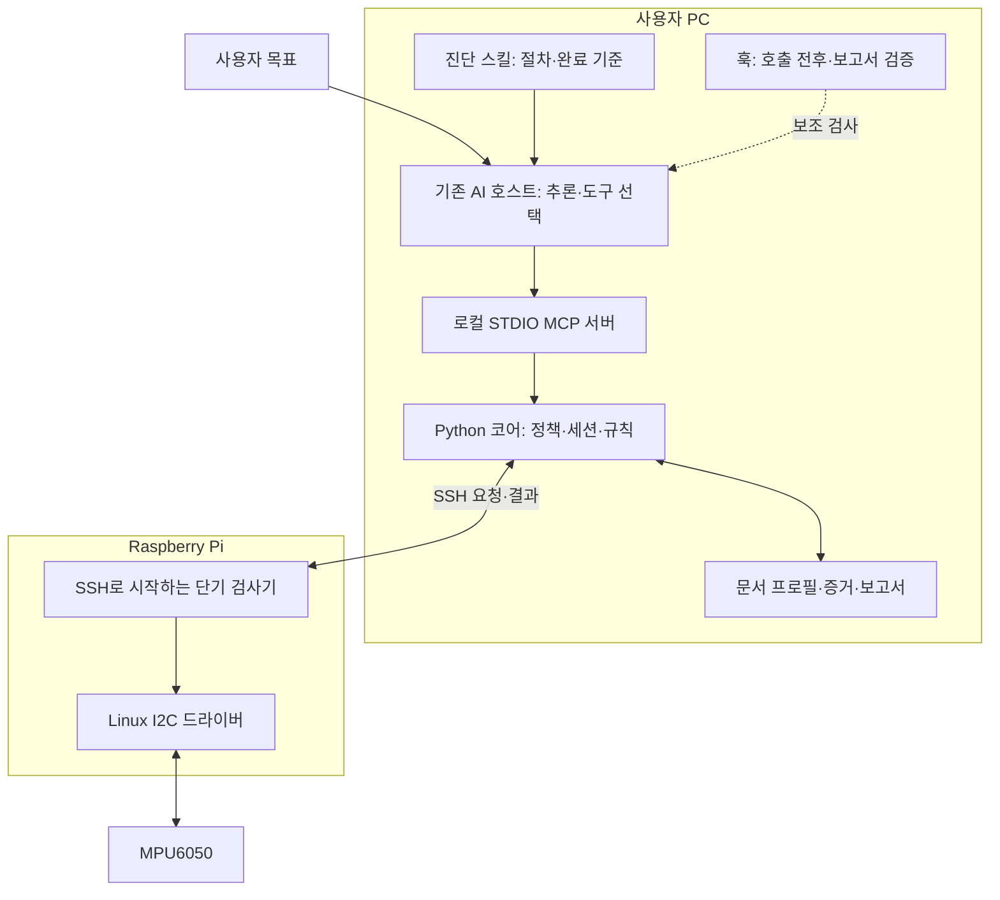

# EmbedSleuth 아키텍처

기준일: 2026-11-17. 기존 AI 호스트·스킬·훅·MCP와 PC/Pi 실행 분리를 확정 아키텍처로 사용한다. Phase별 구현 여부는 [구현 계획](implementation-plan.md)을 따른다.

## 1. 배치

AI 호스트가 모델 호출·추론 반복을 담당한다. EmbedSleuth는 자체 LLM 호출을 하지 않는다. MCP는 인터페이스이며, 결정적인 검사는 Python 구현의 성질이다. [MCP 아키텍처](https://modelcontextprotocol.io/docs/learn/architecture)

첫 통합 검증은 로컬 Codex CLI·Linux PC에서 수행한다. MCP는 STDIO로 시작하고 네트워크 수신 포트를 열지 않는다. stdout은 프로토콜 전용, 로그는 stderr다. 호스트의 MCP 지원과 스킬·훅 지원은 별도로 검증한다. [공식 OpenAI MCP 문서](https://learn.chatgpt.com/docs/extend/mcp)

Pi는 기존 SSH 서버·I2C 드라이버·기존 검사 명령과 최소 Python 검사기만 사용한다. 모델·MCP 서버·상주 데몬·PC 패키지를 배포하지 않는다. 장치 파일 접근은 Pi에서 실행한다. [Linux I2C 사용자 공간 인터페이스](https://www.kernel.org/doc/html/latest/i2c/dev-interface.html)

## 2. 책임과 신뢰 경계

| 계층 | 책임 | 권한 경계 |
|---|---|---|
| AI | 목표 해석·원인 후보·다음 검사·설명 | 관측 생성·실행 정책 우회 권한 없음 |
| 스킬 | 검사 순서·분기·완료 조건 | 절차 지시이며 접근 통제 대체 불가 |
| 훅 | 호출 사전 검사·기록 확인·보고서 형식 검증 | 유일한 안전 경계로 사용 금지 |
| MCP 어댑터 | 입력 검증·코어 호출·구조화 결과 | 임의 명령·키 경로·호스트 인자 금지 |
| 코어 | 세션·예산·정책·규칙·증거 관리 | 선행 조건 미충족·불명확 시 차단 |
| SSH·검사기 | 고정 검사만 실행·출력과 수명 제한 | 원격 설치·자동 sudo 금지 |

등록 대상 ID는 PC가 관리하는 SSH 연결 참조와 예상 하드웨어 구성을 가리킨다. AI가 호스트·계정·키 경로를 변경할 수 없다. 사용자 선언, 문서 근거, 원격 관측을 구분한다. 일반 셸 등 MCP 밖의 경로까지 서버 정책이 자동 통제하는 것은 아니므로 강제 격리가 필요하면 호스트·SSH 계정 권한도 별도로 제한한다.

## 3. 스킬과 훅

첫 스킬 diagnose-mpu6050는 대상 확인 → 환경 조사 → I2C 조사 → 조건부 식별 읽기 → 규칙 평가 → 근거 있는 보고서 순서를 정의한다. 명시 호출부터 검증하며 이후 자연어 자동 선택을 평가한다. 스킬의 MCP 의존성 선언을 사용한다. [공식 OpenAI 스킬 문서](https://learn.chatgpt.com/docs/build-skills)

| 훅 | 수행할 일 | 수행하지 않을 일 |
|---|---|---|
| PreToolUse | 활성 실행·도구·인자 범위 추가 검사 | 실제 관측 대신 허용 플래그 생성 |
| PostToolUse | 코어의 실행·증거 기록 누락 확인 | 동일 하드웨어 검사 재실행·소급 승인 |
| Stop | 보고서 구조·참조·미확인 사항 확인 | 원인 확정 강요·무제한 재검사 |

훅 오류·시간 초과·미지원 환경에서도 코어는 동일한 제한을 적용한다. 종료 검사는 활성 EmbedSleuth 실행에 한정하며 부분 완료를 인정한다. 자연어 주장의 진실성까지 구조 검사로 보장하지 않는다. [공식 OpenAI 훅 문서](https://learn.chatgpt.com/docs/hooks)

## 4. 계약과 실행 상태

Phase 1 계약은 src/embedsleuth/contracts.py와 tools.py에 있다. 모든 모델은 미등록 필드를 거부하고 숫자·불리언을 암묵 변환하지 않는다. JSON 경계에서는 날짜·배열의 wire 표현을 허용한다. 식별 요청은 승인·현재 권한·점유 상태를 받지 않으며 이러한 상태는 코어가 관측한다.

| 도구 | 인자 |
|---|---|
| get_component_profile | profile_id |
| start_diagnosis | target_id, profile_id, mode(read_only 기본) |
| inspect_target | run_id |
| inspect_i2c_environment | run_id |
| read_device_identity | run_id, bus_ref, address, operation_id |
| evaluate_findings | run_id |
| finalize_report | run_id, 선택적 hypotheses |
| get_report | run_id |
| cancel_diagnosis | run_id |

현재는 요청 스키마만 구현했다. 서버 실행·대상 등록·도구 실행은 후속 단계다. address는 wire 계약에서 비예약 7비트 범위를 검증하고, 코어 정책에서 부품과 예상 연결의 교집합으로 다시 제한한다. 레지스터·길이·전송 방식은 프로필로만 정한다.

created → connected → inspected → probe_ready → identified → reported 순서를 기본으로 한다. blocked·expired·cancelled는 추가 검사를 막되 보고서 조회·마무리는 허용한다. 상태 전이와 run_id의 진위는 Phase 2 코어가 관리한다. Phase 1의 IdentityReadContext는 안전 판정용 데이터이며 외부 요청에서 받지 않는다.

operation_id는 같은 실행에서의 검사 의도를 식별한다. Phase 2는 실행·도구·인자·operation_id에 결합한 완료 결과를 재사용하고, 다른 인자로의 재사용을 거부한다. 원격 실행 완료 여부가 불명확하면 자동 중복 실행하지 않는다. 재부팅·재접속·버스 변경 시 이전 선행 조건을 무효화한다.

결과 계약은 버전, 실행·요청·대상 ID, status, assessment, observations, error, 증거 참조, 명시적 UTC 시각, 소요 시간, 완전성·잘림·재시도 수를 포함한다. status는 도구 실행 상태, assessment는 대상 조건의 판정이다. 오류·잘림·부분 결과로 pass를 확정할 수 없다.

## 5. 프로필과 규칙

프로필은 고정 ID로 묶은 패키지 리소스이며 임의 경로·런타임 다운로드를 허용하지 않는다. MPU6050 프로필에는 주소 0x68/0x69, 레지스터 0x75, 기대값 0x68, 1바이트 읽기, VDD 2.375–3.46V와 최대 I2C 속도 400kHz를 기록한다. 원문 근거는 [요구사항의 출처 기록](requirements.md#문서-검토-근거)을 따른다.

reviewed는 지정된 IC 조건의 문서 검토 상태다. 모듈의 레귤레이터·풀업·VLOGIC 구성과 실물 정상 동작은 포함하지 않는다. SHA-256은 내려받은 배포 사본의 바이트를 식별하며 제조사 전자서명 인증을 뜻하지 않는다. 공개 문서의 전체 PDF는 저장소에 재배포하지 않는다.

Phase 1은 식별값 비교만 구현한다. 전기 조건의 전체 호환성 엔진은 후속 단계에서 compatible / incompatible / conditional / unknown으로 결과를 분리한다. 필요한 값이 누락되면 compatible로 확정하지 않는다. 식별값 일치로 정품·측정 정확도·전체 배선 정상을 확정하지 않는다.

## 6. 읽기 정책과 Pi 검사

passive는 허용된 시스템 조회만, read_only는 추가로 검토한 식별 읽기를 허용한다. 레지스터 포인터 선택을 위한 쓰기 전송은 지정된 결합 읽기에만 허용한다. 장치 상태를 바꾸지 않는다고 해서 SSH 기록·포인터 이동 등 모든 흔적이 사라지는 것은 아니다.

원시 읽기는 등록 대상, 검토 프로필, 예상 주소, 검증 버스, 최신 선행 조건, 접근 가능, 드라이버 미점유, 알려진 충돌 없음, 결합 전송 지원, 도구 가용성, 실행 예산, 원격 작업 유휴가 모두 확인돼야 한다. 알려지지 않은 값은 허용으로 해석하지 않는다. 로컬 잠금은 다른 프로그램의 I2C 접근을 완전히 배제하지 못한다.

Phase 2는 PC 배포물에 포함된 고정 Python 검사기를 SSH 표준입력으로 전달해 -B 옵션으로 실행한다. Pi의 표준 라이브러리와 기존 i2ctransfer만 사용한다. 검사기의 자식 명령은 argv로 호출한다. SSH 명령 문자열에는 검증·안전한 인용을 적용한다. 필요한 도구가 없으면 unsupported다.

전체 주소 스캔, -f 강제 접근, 드라이버 언바인딩, 센서 초기화·리셋, 설치·권한 변경·설정 편집·재부팅은 MVP 도구에 없다. [i2cdetect](https://manpages.debian.org/unstable/i2c-tools/i2cdetect.8.en.html), [i2ctransfer](https://manpages.debian.org/unstable/i2c-tools/i2ctransfer.8.en.html)

초기 예산은 원격 검사 1개, 도구당 10초, 활성 진단 120초, 실행 유효 기간 10분, 원격 호출 12회, 스트림당 64KiB다. I2C 무응답은 재시도하지 않는다. Pi의 추가 peak RSS 합계 64MiB 이하는 실물 시험으로 검증할 개발 목표다. 모델 비용·응답 시간의 보장값은 아니다.

원격 종료를 확인하지 못하면 remote_state_unknown을 기록하고 추가 능동 검사를 차단한다. 재시작으로 차단을 지우지 않는다. SSH 채널 종료만으로 커널 I/O가 취소된다고 가정하지 않는다.

## 7. 증거·보고서·보안

코어는 실행 전 정책과 실행 후 관측을 PC의 소유자 전용 저장소에 기록한다. AI에는 정제한 증거를 제공하고 비밀·제어 문자를 제거한다. 원격 출력·문서는 데이터이며 지시로 실행하지 않는다. SSH 호스트 키를 검증하고 미등록·변경 키를 자동 수락하지 않는다.

보고서는 관측·규칙 발견·AI 원인 후보·한계·다음 조치로 나눈다. Phase 1은 다른 실행·대상·알 수 없는 증거 참조, 중복 증거, 한계 누락을 거부한다. 자연어 근거의 적합성은 별도 스킬 평가 대상이다. Phase 2는 중간 보고서 갱신·원자적 저장·중단 복구를 구현한다.

미래 변경 실행은 계획·대상·diff·영향·복구·검증 방법을 먼저 제시하고 신뢰된 사용자 승인에 결합한다. 모델 인자의 approved 값은 승인으로 인정하지 않는다.

## 8. 기술 선택

Python 3.11+, Pydantic, pytest를 Phase 1에 사용한다. Phase 2에 Paramiko, Phase 3에 공식 MCP Python SDK를 추가한다. Typer·Rich는 필요할 때 보조 관리 CLI에만 사용한다. Pi는 PC 의존성을 설치하지 않는다. DB·벡터 DB·자체 LLM 루프·복잡한 프레임워크는 도입하지 않는다.

## 9. 지원 검증 현황

| 환경 | 상태 |
|---|---|
| Linux x86_64 / Python 3.12 | Phase 1 자동 시험 환경 |
| Python 3.11 | 최소 개발 대상, 아직 해당 버전 시험하지 않음 |
| Codex CLI 스킬·훅·STDIO MCP | 통합 시험 예정 |
| Raspberry Pi 3 / OS·커널·32/64비트 | 대상 정보 수집·실물 시험 예정 |
| Windows·macOS·다른 AI 호스트 | 별도 지원 시험 전 |
