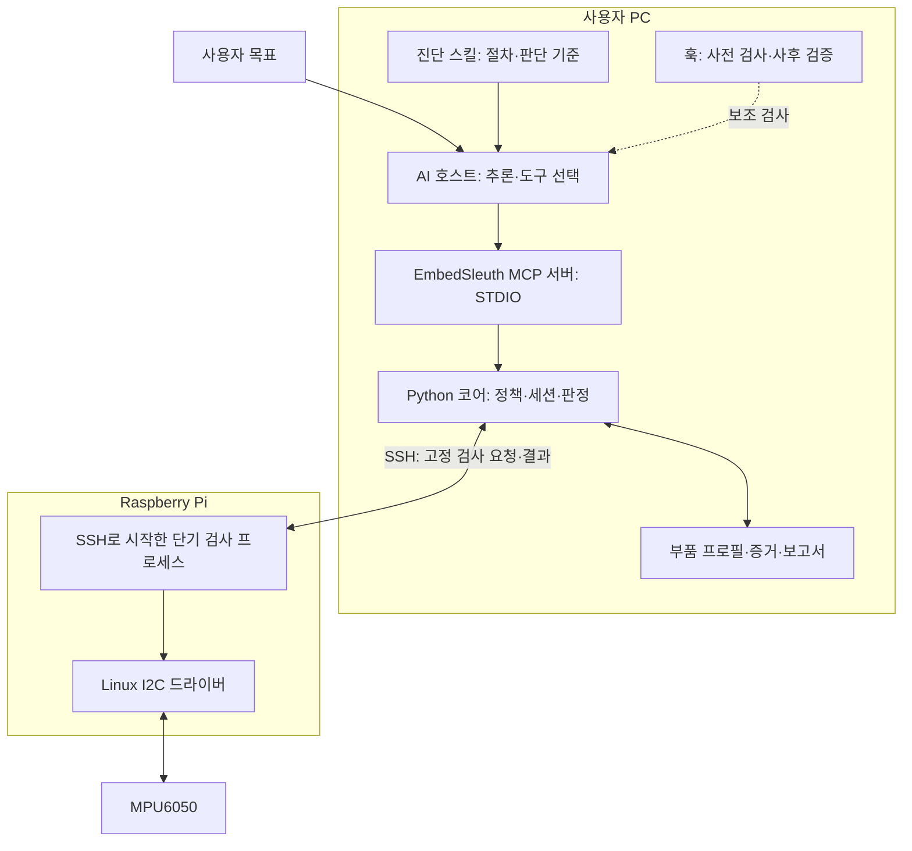

# EmbedSleuth 설계안

작성일: 2026-11-17 (Asia/Seoul)

상태: 이전 설계 논의 기록. 사용자 승인으로 Phase 1 구현을 시작했다. 현재 규격은 [architecture.md](architecture.md), [requirements.md](requirements.md), 진행 상태는 [implementation-plan.md](implementation-plan.md)를 따른다. 아래의 승인 대기·원문 미확보 표현은 당시 상태를 기록한 것이며 현재 상태가 아니다.

## 1. 제품 정의와 설계 결정

EmbedSleuth는 기존 AI 호스트에 스킬·훅·MCP 도구를 결합해, 데이터시트 기반 부품 호환성을 검토하고 실제 임베디드 장치를 진단하는 에이전트 패키지다.

- AI 호스트가 목표 해석, 원인 추론, 다음 검사 선택, 설명을 담당한다.
- 스킬은 목표별 진단 절차와 판단·완료 기준을 정의한다.
- 훅은 도구 호출 전후와 작업 종료 시 보조 검사·기록 검증을 수행한다.
- PC의 MCP 서버와 Python 코어가 허용된 결정적 검사, 증거 관리, 안전 정책을 담당한다.
- 하드웨어 접근이 필요한 명령은 SSH를 통해 Raspberry Pi 안에서 필요한 동안만 실행한다.
- Pi에는 LLM, 스킬·훅 실행 환경, MCP 서버, 상주 EmbedSleuth 데몬을 설치하지 않는다.
- 첫 MVP는 읽기 전용 진단과 해결 방법 제안까지다. 변경 실행 기능은 후속 단계다.
- EmbedSleuth 자체의 LLM API 호출 루프와 복잡한 에이전트 프레임워크는 MVP에 도입하지 않는다.

MCP는 도구와 문맥을 연결하는 프로토콜이며 추론 엔진이 아니다. 이 설계에서 AI가 개입하지 않는다는 것은 MCP 뒤의 검사 구현이 LLM을 호출하지 않는다는 뜻이다. MCP 서버만으로 에이전트 전체가 완성되지는 않으며, 호스트·스킬·훅·진단 코어를 합친 구성이 제품이다. [MCP 공식 아키텍처](https://modelcontextprotocol.io/docs/learn/architecture)

## 2. 사용 방식과 지원 범위

사용자는 기존 AI CLI에서 스킬을 명시적으로 호출하거나 자연어로 진단을 요청한다. 별도 대화형 EmbedSleuth 콘솔을 열 필요는 없다. 정확한 호출 문법은 선택한 호스트의 기능에 맞춰 구현 단계에서 확정한다.

사용 예: “EmbedSleuth로 등록된 lab-pi의 MPU6050 인식 문제를 진단해 줘. 시스템은 변경하지 마.”

| 구분 | MVP 제안 |
|---|---|
| 1차 호스트 | 로컬 Codex CLI를 우선 검증 대상으로 제안. 다른 호스트는 별도 어댑터·인수 시험 후 지원 |
| PC 환경 | Linux 우선. Windows·macOS는 추가 시험 후 지원 |
| 대상 | Raspberry Pi 3 + Raspberry Pi OS + MPU6050 I2C 연결 |
| 대상 선택 | 사용자가 PC에 등록한 target_id. AI에 임의 호스트·계정·키 경로 입력 권한을 주지 않음 |
| 입력 | 대상 ID, 부품 프로필, 증상, 선택적 버스·주소·모듈 정보 |
| 출력 | 관측 사실, 확정 가능한 발견 사항, 원인 후보, 미확인 사항, 다음 조치 |
| 진단 모드 | 기본 read_only, 장치 통신을 생략하는 passive |
| 실행 단위 | 한 실행에 한 대상, 버스 접근 순차 실행 |

Pi 3 세부 모델, OS 이미지, 커널, 32/64비트, 원격 Python·i2c-tools 버전은 실제 시험 결과로 지원 목록을 고정한다. 미시험 조합은 지원을 보장하지 않고 부분 검사 결과와 한계를 반환한다.

대상 등록 정보는 SSH 연결 참조와 예상 하드웨어 연결을 나누어 보관한다. 예상 연결에는 보드·부품 프로필, 모듈 제품 정보, 선택적 버스·주소·AD0 조건을 담는다. 사용자가 선언한 값, 문서에서 확인한 값, 장치에서 관측한 값을 서로 구분해 보고한다.

Codex는 로컬 STDIO MCP 서버를 지원한다. 호스트별 스킬·훅 기능은 MCP와 별도로 검증해야 한다. 특히 클라우드 조정 환경에서 로컬 훅을 그대로 사용할 수 있다고 가정하지 않는다. [공식 OpenAI MCP 문서](https://learn.chatgpt.com/docs/extend/mcp)

MVP 제외 범위: 임의 PDF에서 부품을 자동 등록하는 기능, 전체 주소 스캔, 센서 깨우기·리셋·보정, 정확도·정품 판정, DMP·자세 추정, 장기 모니터링, 다중 대상 병렬 진단, 자동 복구, 공개 원격 MCP 서비스.

## 3. 요구사항

| ID | 요구사항 | 검증 기준 |
|---|---|---|
| FR-01 | 등록된 Pi에 SSH로 접속 | 신뢰·네트워크·인증 실패를 각각 보고 |
| FR-02 | 보드·OS·도구·I2C 실행 환경 조회 | 실제 관측과 설정 추정을 분리 |
| FR-03 | 버스·권한·드라이버 점유 확인 | 권한 거부와 센서 이상을 구분 |
| FR-04 | 검토된 프로필의 식별 레지스터만 읽기 | 허용 범위를 벗어난 접근 거부 |
| FR-05 | 규칙 기반 결과와 AI 원인 후보 제공 | 각 주장에 증거·문서 참조 또는 미확인 표시 |
| FR-06 | JSON 보고서와 사용자 설명 제공 | 증거 ID, 버전, 검사 누락, 다음 조치 포함 |
| FR-07 | 데이터시트 조건 비교 | 필요한 정보 누락 시 호환으로 확정하지 않음 |
| NFR-01 | 기본 진단에서 시스템·센서 설정 변경 금지 | 미승인 변경 시험 전부 차단 |
| NFR-02 | Pi의 자원 사용 제한 | 단기 프로세스, 순차 접근, 실물 자원 측정 |
| NFR-03 | 재현 가능한 증거 기록 | 도구·프로필·정책 버전과 실행 조건 보존 |
| NFR-04 | 부분 실패 허용 | 검사 불가·오류·대상 이상을 구분해 종료 |
| NFR-05 | 비밀 최소 노출 | SSH 비밀을 모델·보고서·명령 인자에 포함하지 않음 |
| NFR-06 | AI 호스트 중단 시도 결과 보존 | 이미 저장된 관측은 로컬에서 조회 가능 |

## 4. 배치와 실행 경계

PC는 모델 연결, 문서 검색·프로필, SSH 클라이언트, 세션 예산, 결과 해석과 저장을 맡는다. 모델 추론의 실제 위치는 호스트의 설정에 따라 클라우드 또는 별도 로컬 모델 서버가 될 수 있다.

Pi는 기존 SSH 서버와 I2C 드라이버, 기존 검사 유틸리티 및 필요한 경우 최소 Python 검사기만 실행한다. Linux 사용자 공간의 I2C 접근은 Pi의 /dev/i2c-N에서 수행한다. PC의 장치 파일을 읽어 원격 센서를 검사할 수는 없다. [Linux I2C 인터페이스](https://www.kernel.org/doc/html/latest/i2c/dev-interface.html)

PC의 MCP 서버는 호스트가 백그라운드 로컬 프로세스로 시작한다. STDIO 전용이므로 MVP에서 네트워크 수신 포트를 열지 않는다. 프로토콜 stdout과 로그 stderr를 분리한다.

## 5. AI·스킬·훅의 역할

### 5.1 AI 호스트

AI는 필수 검사 이후의 안전한 추가 검사 선택, 모순되는 증거 설명, 원인 후보 작성, 사용자 설명을 담당한다. 사실·오류 코드·식별 일치 판정은 도구 결과를 사용한다. 성공을 추정하거나 수치를 만들어 보고하지 않는다.

호스트의 모델 인증·요금 정책을 사용하며 EmbedSleuth는 별도 LLM API 키를 요구하지 않는다. MCP 사용이 모델 이용을 무료로 만든다는 의미는 아니다. 모델 연결 장애 시 자율 추론은 중단되지만 저장된 증거와 결정적 보고서는 유지된다.

### 5.2 첫 스킬: diagnose-mpu6050

입력, 도구 의존성, 선행 조건, 정상·실패·미확인 분기, 설명 방식, 종료 조건을 담는다. 검사 순서를 문장으로 안내하되 강제해야 할 선행 조건은 코어에도 구현한다.

1. 대상과 예상 부품·연결 정보를 확인한다.
2. 진단 실행을 생성하고 도구·프로필 버전을 확인한다.
3. SSH와 대상 환경을 검사한다.
4. I2C 구성·버스·권한·점유 상태를 확인한다.
5. read_only 모드이며 조건이 충족된 경우에만 식별 검사를 선택한다.
6. 규칙 기반 발견 사항을 받아 AI 원인 후보와 구분한다.
7. 검사 범위, 근거, 미확인 사항, 다음 조치를 보고한다.

사용자가 선언한 버스·주소도 관측과 대조한다. 대상이 불명확하거나 정책 밖이라면 하드웨어 접근 전에 멈추고 필요한 정보만 요청한다. 사용 불가능한 검사도 이유를 남기면 정상적인 종료가 될 수 있다.

첫 MVP는 작업 단위 스킬 하나로 시작한다. 이후 compatibility-review 등으로 확장하며, 도구별로 얇은 스킬을 다수 만들지는 않는다. 스킬은 MCP 의존성을 선언할 수 있다. [공식 OpenAI 스킬 문서](https://learn.chatgpt.com/docs/build-skills)

### 5.3 훅

| 시점 | 보조 기능 | 금지할 책임 |
|---|---|---|
| PreToolUse | EmbedSleuth 도구 인자·실행 ID 형식과 대상 범위 추가 확인 | 검사 선행 조건·하드웨어 안전성의 유일한 강제 지점 |
| PostToolUse | 서버가 기록한 실행·증거 ID 누락 확인, 상관관계 기록 | 실행 완료 작업의 취소나 소급 승인 |
| Stop | 완료·부분 완료 실행에 대해 보고서와 필수 항목 존재 확인 | 모든 원인 확정 요구, 무제한 재검사 유도 |

기록의 원본은 MCP 코어가 실행 전후 남기며, 훅은 이를 검증한다. 훅에서 동일한 하드웨어 검사를 다시 수행하지 않는다. 다른 작업이나 대화의 종료에는 개입하지 않도록 활성 EmbedSleuth 실행에 한정한다.

보고서 검증은 구조·필수 항목·유효 증거 참조를 확인한다. 자연어 원인 설명의 진실성까지 결정적으로 보장하지는 못한다. 알려진 증거 참조만 붙인 근거 없는 추론도 평가 시험에서 점검한다.

훅 오류·시간 초과가 항상 도구 차단을 의미하지 않으며, 지원은 호스트·실행 환경에 의존한다. 훅이 없어도 코어 정책이 적용되어야 한다. 초기 호스트 연결 시 신뢰 설정과 이벤트 동작을 시험한다. [공식 OpenAI 훅 문서](https://learn.chatgpt.com/docs/hooks)

## 6. Pi의 원격 검사 방식과 자원 관리

### 6.1 MVP 실행 방식

- 메타데이터와 구성은 허용된 파일·sysfs 및 고정 조회 명령으로 수집한다.
- 복잡한 수집은 PC 배포물에 포함된 버전 고정 Python 검사기를 SSH 표준입력으로 전달해 실행한다. LLM이 검사기 코드를 작성하지 않는다.
- Python 검사기는 표준 라이브러리만 사용하며 바이트코드 캐시를 쓰지 않도록 실행한다. 원격 파일 업로드·pip 설치·상주 서비스 등록은 하지 않는다.
- 센서 읽기는 이미 설치된 i2ctransfer를 고정 인자로 호출한다. 수집기는 명령을 argv 형태로 실행하고 셸 해석을 추가하지 않는다.
- 원격 Python 또는 i2ctransfer가 없으면 가능한 환경 조회만 수행하고 필요한 검사를 unsupported로 반환한다. 대체 도구를 임의로 선택하거나 설치하지 않는다.
- Python 검사기가 필요한 경로를 MVP 표준 경로로 검증하고, 기존 명령만으로 가능한 부분 조회는 제한된 대체 경로로 문서화한다.

초기에는 직접 ioctl ABI를 구현하거나 Pi에 smbus2를 설치하는 방식보다 기존 i2c-tools를 감싸는 구현이 검토 범위를 줄인다. 의존성이 없는 장치까지 지원하려면 후속으로 별도 백엔드를 추가하고 동등성·안전성 시험을 수행한다.

### 6.2 자원·시간 예산 제안

| 항목 | 초기 제안 | 처리 |
|---|---|---|
| 동시 원격 검사 | 대상당 1개 | 같은 실행·프로세스가 만든 버스 접근 직렬화 |
| 전체 원격 검사 프로세스의 추가 메모리 | peak RSS 합계 64 MiB 이하를 개발 목표로 제안 | SSH 세션 자원도 함께 측정. 측정 전 보장하지 않음 |
| SSH 연결·인증 | 단계별 10초 | 원인 분류 후 종료 |
| 일반 원격 도구 | 10초 | 남은 실행 예산 내에서 제한 |
| 전체 활성 진단 시간 | 120초 | 이후 새로운 원격 검사 차단 |
| 실행 유효 기간 | 10분 | 만료 후 새 실행 필요 |
| 원격 검사 호출 | 실행당 최대 12회 | 로컬 프로필·보고서 조회는 별도 |
| 도구 출력 | 스트림당 64 KiB | 한도 초과 시 잘림 표시, 불완전 자료로 확정하지 않음 |

시간은 코어가 단조 시계로 측정한다. 위 수치는 구현·실물 시험으로 확정할 제안이며 모델 응답 시간·비용의 상한을 보장하지 않는다. I2C 무응답·시간 초과에서는 자동 재접근하지 않는다. 다른 일시적 오류도 명시적으로 안전하다고 분류된 조회에 한해 최대 1회 재시도한다.

원격 프로세스와 자식 프로세스 종료를 관리하고 시간 초과 후 종료 확인을 시도한다. SSH 채널 종료가 커널 I/O 취소를 보장하지는 않는다. 종료를 확인하지 못하면 remote_state_unknown으로 표시하고 해당 대상의 추가 능동 검사를 차단한다. 서버 재시작만으로 이 상태를 지우지 않는다.

차단 해제에는 추가 수동 조회로 종료를 확인하거나 사용자가 외부에서 복구한 상태를 확인하는 절차가 필요하다. 진단기가 임의로 재부팅·드라이버 재설정해 해제하지 않는다.

PC의 대화 기록·데이터시트·보고서를 Pi로 보내지 않는다. Pi에는 현재 검사에 필요한 최소 인자만 전달한다.

## 7. 진단 상태와 도구 인터페이스

실행 상태의 원본은 MCP 코어가 관리한다. run_id는 승인 토큰이 아니며 만료·정책 검증을 생략하게 하지 않는다. 호스트 키, 대상 설정 개정, 관측한 boot ID, 버스 식별 정보를 실행에 결합한다. 재접속·재부팅·대상 변경으로 근거가 달라지면 선행 조건을 다시 확인한다.

| 상태 | 의미 |
|---|---|
| created | 등록 대상과 프로필·모드·예산 확정 |
| connected | SSH 신뢰·인증 확인 |
| inspected | 보드·도구·I2C 환경 조사 |
| probe_ready | 제한된 식별 읽기의 선행 조건 충족 |
| identified | 읽기 결과 수집. 성공·불일치·통신 실패를 포함 |
| reported | 완료 또는 부분 완료 보고서 생성 |
| blocked / expired / cancelled | 추가 검사 중단. 기존 증거로 보고서 생성 가능 |

다음은 API 계약 제안이며 실행 코드나 MCP 설정은 아니다.

| 도구 | 입력 | 결과·정책 |
|---|---|---|
| get_component_profile | profile_id | 검토 상태, 필요한 조건, 문서 참조. 임의 파일 경로 불허 |
| start_diagnosis | target_id, profile_id, mode | run_id, 예산, 정책·프로필 버전. 등록 대상만 허용 |
| inspect_target | run_id | SSH·보드·OS·커널·원격 도구 상태 |
| inspect_i2c_environment | run_id | 버스 참조, 설정 근거, 장치 노드, 권한·점유·전송 기능 |
| read_device_identity | run_id, bus_ref, profile 내 주소 | 식별 바이트·전송 오류. passive 및 선행 조건 미충족이면 거부 |
| evaluate_findings | run_id | Python 규칙으로 발견 사항·미확인 사항 산출 |
| finalize_report | run_id, 선택적 구조화 AI 원인 후보 | 관측은 저장된 증거로 구성. 원인 후보는 AI 작성임을 표시 |
| get_report | run_id | 해당 실행의 구조화 보고서와 검증 상태 |
| cancel_diagnosis | run_id | 새 검사 차단, 진행 작업 종료 시도, 부분 보고서 생성. 종료 불명확 상태는 유지 |

bus_ref는 현재 실행에서 수집한 어댑터 참조다. 임의 /dev 경로, 레지스터, 길이, 전송 플래그, 셸 명령을 받지 않는다. 주소는 부품 프로필과 등록된 연결 범위로 제한한다. 미등록 부품 프로필이나 검토되지 않은 프로필은 능동 검사를 허용하지 않는다.

### 7.1 공통 결과 계약

| 필드 | 의미 |
|---|---|
| schema_version, tool_version, policy_version, profile_version | 재현성과 호환성 기준 |
| run_id, target_id, execution_id, request_id | 실행·요청 상관관계 |
| status | ok / error / blocked / unsupported / timeout |
| assessment | pass / fail / unknown / not_applicable |
| observations, error_code | 정규화한 관측·실패 유형 |
| evidence_ids, collected_at, duration_ms | 근거 참조, UTC 시각, 소요 시간 |
| completeness, truncated, retry_count | 부분 수집·잘림·재시도 여부 |

도구 실행 성공과 검사 통과를 구분한다. 예를 들어 권한 검사는 성공적으로 수행됐지만 접근이 거부될 수 있다. 센서 통신 오류가 보고되면 식별 판정은 unknown으로 남길 수 있다.

오류 분류에는 host_key_unknown, host_key_mismatch, authentication_failed, network_timeout, dependency_missing, permission_denied, adapter_not_found, driver_bound, transfer_failed, identity_mismatch, policy_denied, resource_limit, remote_state_unknown 등을 포함한다. errno·표준 오류 원문도 제한적으로 보존하되 한 오류를 곧바로 특정 배선 결함으로 해석하지 않는다.

요청 ID를 통해 완료된 요청의 전달 재시도는 저장 결과를 반환한다. 실행 완료 여부가 불명확한 능동 요청을 중복 실행하지 않는다. 새로운 관측이 필요하면 별도 검사 요청으로 기록한다.

## 8. MPU6050 진단과 데이터시트 호환성

### 8.1 검사 내용

1. SSH 실패와 하드웨어 진단 불가를 분리한다.
2. 보드·OS·버스 정보를 수집하고 예상 구성과 비교한다.
3. /boot/firmware/config.txt 및 이전 배치의 /boot/config.txt를 실제 경로와 실행 상태를 고려해 조사한다. 조건·include는 경로·깊이·크기를 제한해 해석하고 불완전하면 표시한다.
4. 실행 중인 Device Tree와 어댑터·장치 노드를 확인한다. 설정 파일의 문자열 하나나 lsmod에 모듈이 없다는 사실만으로 활성 상태를 확정하지 않는다.
5. 커널 드라이버 바인딩, 계정 접근, 어댑터 기능을 검사한다. sysfs의 장치 선언·바인딩도 센서의 실제 응답과 구분한다.
6. 예상 연결과 위험 조건을 확인한 경우에만 프로필의 식별 레지스터를 읽는다.
7. 관측과 원인 후보를 구분해 보고한다.

버스 번호를 무조건 1로 확정하지 않는다. Linux는 어댑터 번호의 동적 배정을 설명한다. 설정 파일은 실행 상태와 다를 수 있으며 부팅 설정 변경의 적용에는 재부팅이 필요할 수 있다. [Linux I2C 문서](https://www.kernel.org/doc/html/latest/i2c/dev-interface.html), [Raspberry Pi config.txt 문서](https://www.raspberrypi.com/documentation/computers/config_txt.html)

프로필 초안의 식별 규칙은 후보 주소 0x68·0x69, WHO_AM_I 레지스터 0x75, 기대값 0x68이다. AD0가 주소를 0x69로 바꾸어도 WHO_AM_I를 0x69로 기대하지 않는다. 이 값과 읽기 부작용은 RM-MPU-6000A-00 원문을 확보·검토한 뒤 프로필을 reviewed로 전환해야 한다. 기존 제조사 레지스터 맵 링크의 검색 내용은 확인했으나 직접 원문 열람이 불안정했으므로 문서 해시나 검토 완료 상태를 미리 부여하지 않는다. [제조사 레지스터 맵 링크](https://invensense.tdk.com/wp-content/uploads/2015/02/MPU-6000-Register-Map.pdf)

주소·전기 조건의 제품 사양 근거는 PS-MPU-6000A-00 Revision 3.4다. [TDK 제품 사양서](https://product.tdk.com/system/files/dam/doc/product/sensor/mortion-inertial/imu/data_sheet/mpu-6000-datasheet1.pdf)

### 8.2 관측의 해석 한계

| 관측 | 보고할 수 있는 결론 | 확정하면 안 되는 결론 |
|---|---|---|
| I2C 장치 노드 없음 | 사용자 공간 접근 경로를 확인하지 못함 | 센서 고장 |
| 접근 거부 | 현재 계정으로 검사를 수행할 수 없음 | 배선 불량 |
| 드라이버 바인딩 | 원시 접근 정책상 검사 중단 | 실제 센서 정상 응답 |
| 전송 실패 | 해당 조건에서 통신 실패 | 반드시 단선 또는 센서 사망 |
| 식별값 일치 | 예상 부품 프로필과 일치하는 식별 응답 | 정품·측정 정확도·전체 연결 정상 |
| 식별값 불일치 | 프로필과 불일치 | 즉시 위조품 판정 |

### 8.3 호환성 프로필

프로필은 제조사·부품·IC/모듈 구분, 공급·논리 전압, 입력 임계값, 버스·주소·속도, 식별 규칙, 읽기 허용 목록·부작용, 문서 번호·개정·절·페이지·원문 해시, 검토 상태를 포함한다.

Python이 조건을 비교해 compatible / incompatible / conditional / unknown을 산출한다. 전체 판정은 지원하는 조건의 범위 안에서만 제시하고, 누락된 전기·모듈 정보는 unknown 또는 conditional로 남긴다. 런타임 통신 성공과 데이터시트 호환성은 별도 결과다.

Pi GPIO는 3.3V이며 5V 내성이 없다. 실제 MPU6050 모듈의 레귤레이터·풀업·논리 전압은 IC 사양만으로 확정하지 않는다. SSH는 실제 전압·단선·풀업 저항을 측정하지 못한다. [Raspberry Pi 하드웨어 문서](https://www.raspberrypi.com/documentation/computers/raspberry-pi.html)

초기에는 사람이 검토한 프로필만 사용한다. 이후 문서 추출 기능을 추가해도 LLM 추출값은 검토 후보로 저장하며 곧바로 실행 권한이나 전기적 안전 기준으로 사용하지 않는다. MVP 런타임에서 임의 URL·PDF를 자동 다운로드하지 않는다.

## 9. 안전 정책과 신뢰 경계

### 9.1 읽기 전용 정의

| 등급 | 예시 | 정책 |
|---|---|---|
| passive | OS·설정·sysfs·권한 조회 | 허용된 경로·명령에 한해 기본 허용 |
| 제한된 장치 읽기 | 검토된 식별 레지스터 읽기 | read_only 모드, 예상 연결, 점유·버스 조건 충족 시 허용 |
| 상태 변경 | 센서 깨우기·리셋, modprobe, chmod, 그룹 변경, 설치, 설정 편집, 재부팅 | MVP 도구에 포함하지 않음 |
| 범용 위험 접근 | 전체 스캔, 강제 접근, 드라이버 언바인딩, 임의 레지스터·셸 실행 | 금지 |

읽기 전용은 운영 설정과 센서 제어 상태를 변경하지 않는다는 의미다. SSH 로그, 프로세스 실행, 장치 통신, 레지스터 포인터 선택 등 모든 흔적·일시 상태가 전혀 변하지 않는다는 뜻은 아니다. 장치 읽기도 부품에 따라 부작용이 있으므로 검토한 레지스터만 허용한다.

I2C 레지스터 선택을 위한 쓰기 바이트는 프로필에 정의된 읽기 전송에만 허용한다. 임의 쓰기 기능으로 일반화하지 않는다. 전체 i2cdetect 스캔은 임의 SMBus 명령의 부작용 때문에 사용하지 않는다. i2ctransfer의 강제 점유 우회 옵션도 금지한다. [i2cdetect 매뉴얼](https://manpages.debian.org/unstable/i2c-tools/i2cdetect.8.en.html), [i2ctransfer 매뉴얼](https://manpages.debian.org/unstable/i2c-tools/i2ctransfer.8.en.html)

### 9.2 대상·인증·전송

- 사람이 등록한 대상의 호스트·사용자·포트·키 참조만 사용한다. 로컬 별칭 target_id를 모델에 제공한다.
- 등록된 SSH 호스트 키를 검증하고 미등록·변경 키는 거부한다. 키 등록은 진단 밖의 사용자 설정 절차다.
- 비특권 계정과 SSH 키·에이전트를 우선한다. 자동 sudo, 인증 우회, 에이전트 포워딩을 하지 않는다.
- SSH 비밀과 원격 실행 인자는 필요한 프로세스에만 전달한다. 비밀을 MCP 인자·LLM·보고서에 넣지 않는다.
- 원격 실행 템플릿과 검사기는 배포물의 고정 코드다. SSH 명령 문자열이 필요한 부분은 타입·허용 목록 검증과 셸 인용을 적용하며 LLM 출력은 코드로 사용하지 않는다.

### 9.3 정책 강제와 남는 위험

- 정책을 훅·스킬 지시문이나 MCP 도구 메타데이터에만 의존하지 않는다. 서버와 원격 검사기의 고정 허용 범위로 제한한다.
- 드라이버 점유 시 원시 접근을 거부한다. 다른 사용자 공간 프로그램의 접근을 완전히 탐지·배제할 수는 없다. 사용 중인 장치나 연결이 불명확한 경우 능동 검사를 생략한다.
- 로컬 잠금은 EmbedSleuth 내부 동시 접근만 막으며 다른 프로그램·다른 I2C 마스터를 배제하지 못한다.
- MCP의 정책은 호스트의 일반 셸 등 별도 SSH 경로를 자동으로 통제하지 않는다. 지원 진단 절차는 EmbedSleuth 도구만 사용하도록 정의하고, 강제 격리가 필요한 배포는 호스트 권한·SSH 계정의 별도 제한을 함께 구성해야 한다.
- 손상된 Pi가 허위 응답을 반환하는 문제나 실제 센서와 응답 출처의 하드웨어 증명은 MVP 보장 범위 밖이다.

### 9.4 데이터 취급

원격 출력·데이터시트·모듈 설명은 지시가 아닌 데이터로 취급한다. 출력의 제어 문자·터미널 이스케이프와 비밀을 정제하고 모델에는 필요한 정규화 증거만 전달한다. 민감한 원문은 정제 전 디스크 저장을 기본으로 하지 않는다.

실행별 JSON·JSONL을 사용자 PC의 소유자 전용 디렉터리에 저장한다. 경로는 서버가 생성하고 AI가 임의 경로를 지정하지 않는다. 보고서는 원자적으로 저장하며 정책·실행 이력은 추가 기록한다. 기본 외부 분석 전송은 없고 삭제 기능으로 보존 기간을 관리한다. 자동 삭제 정책은 구현 시 문서화한다. 내보내기 보고서에서 호스트·사용자 등 식별 정보는 기본 마스킹한다.

### 9.5 후속 승인형 변경

추후 변경 도구를 추가할 때 대상·현재 상태·변경 diff·영향·권한 상승·복구·검증 방법을 포함한 계획을 먼저 만든다. 승인은 신뢰된 사용자 상호작용을 통해 계획 해시·대상·유효 기간에 결합한다. LLM이 전달한 approved 값은 승인으로 인정하지 않는다. 실행 직전 상태가 바뀌면 재계획하고 재승인한다. 자동 복구·재부팅은 별도 승인을 필요로 한다.

## 10. 증거와 최종 보고서

증거는 실행 중 서버가 관측한 사실의 원본이다. 도구 요청, 실행 전 정책 판단, 종료·오류·정규화 결과를 코어에서 기록한다. 기록 실패로 실행 이력을 보장할 수 없으면 새로운 원격 검사를 시작하지 않는다.

보고서는 다음을 포함한다.

1. 대상 별칭·환경·프로필·정책·도구 버전과 진단 범위.
2. 검사별 상태·판정·증거 ID·누락 이유.
3. 규칙으로 확인된 발견 사항과 문서 근거.
4. AI 원인 후보, 지지·반대 증거, 아직 필요한 확인.
5. 미확인 사항과 통신·전기·소프트웨어 판정의 한계.
6. 수동 확인과 승인 필요한 변경 제안.
7. 완료 / 부분 완료 / 중단 및 그 이유.

AI가 finalize_report에 제출하는 것은 원인 후보와 설명뿐이다. 도구 실행 여부·관측값·규칙 결과는 저장 증거에서 채운다. 알 수 없는 증거 ID, 다른 실행의 증거, 비밀 포함 내용은 거부한다. 자연어 설명의 증거 적합성은 별도 품질 평가 대상이다. 확률 수치는 검증된 보정 체계가 없으면 제시하지 않는다.

보고서는 JSON을 기준 산출물로 삼고, 호스트가 사용자 설명을 작성한다. Stop 훅은 보고서를 확인하지만 보고서 생성 자체가 훅 성공에 의존하지는 않는다. 부분 실패·취소 시에도 수집된 증거로 보고서를 만들 수 있다.

각 검사 뒤 코어가 AI 설명 없는 중간 보고서도 갱신한다. 정상 종료·취소·예산 만료에서는 이를 결정적 최종 보고서로 마무리한다. 강제 종료나 전원 장애로 마무리하지 못하면 다음 시작 때 기록을 복구해 중단 상태로 보고하고, 완료 여부가 불명확한 원격 검사를 재실행하지 않는다.

## 11. 기술 선택과 트레이드오프

| 기술 | 선택 | 이유·대가 |
|---|---|---|
| Python | PC 코어 3.11 이상을 제안 | 타입·SSH·테스트 생태계. 정확한 지원 버전은 SDK와 함께 고정 |
| 공식 MCP Python SDK | 채택 | STDIO·도구 스키마를 직접 구현하는 부담 감소. 검증한 릴리스 고정 |
| Paramiko | PC SSH 백엔드 | Python에서 세션·오류 관리. OpenSSH의 모든 설정·ProxyJump를 동일 지원한다고 약속하지 않음 |
| Pydantic | 계약·프로필 검증 | 런타임 타입·스키마 검증. 도메인 판정은 별도 Python 규칙 |
| pytest | 테스트 | 단위·가짜 전송·MCP·실물 시험에 공통 사용 |
| Typer·Rich | 보조 관리 CLI·개발 도구에 선택 사용 | 주 사용자 경로는 기존 AI CLI. MCP stdout에는 Rich 출력 금지 |
| Pi의 Python 3 | 최소 검사기 | PC 패키지 전체를 설치하지 않음. 실제 OS 버전별 지원 시험 |
| i2c-tools | 기존 설치본의 제한된 전송 | 원격 의존성 필요. 없으면 설치 승인이 필요한 미충족 조건으로 보고 |
| 저장 | JSON·JSONL | 초기 실행 기록에 충분. DB·벡터 DB는 보류 |
| AI 프레임워크·직접 LLM SDK | MVP 제외 | 호스트의 실행 루프 재사용. 호스트 변경 시 스킬·훅 어댑터 시험 필요 |

[공식 MCP Python SDK](https://github.com/modelcontextprotocol/python-sdk), [Paramiko 문서](https://docs.paramiko.org/en/stable/api/client.html)

MCP 통신은 SDK에 맡기고 원격 검사 코어는 순차 실행으로 시작한다. 호스트의 반복 추론을 대신할 별도 AI 상태 머신은 만들지 않는다. 서버의 상태 관리는 검사 선행 조건·예산·기록에 한정한다.

## 12. 테스트 전략과 인수 기준

| 수준 | 시험 내용 |
|---|---|
| 단위 | 주소·식별 규칙, 호환성 누락 처리, 설정·sysfs 파싱, 오류 분류 |
| 정책 | 임의 대상·경로·레지스터·플래그 거부, passive 능동 접근 차단, 만료·상태 변경 |
| 원격 검사기 | 고정 요청 형식, 자식 종료, 출력 제한, 비밀·제어 문자 정제, 설치 없는 동작 |
| SSH 통합 | 미등록·변경 키, 인증 실패, 단절, 대량 출력, 종료 불명확 |
| MCP 통합 | STDIO 초기화·스키마·호출·구조화 오류, stdout 오염 방지, 중복 요청 |
| 훅 통합 | 지원 이벤트와 매칭, 비활성·오류·시간 초과에도 코어 제한 유지, 무관한 작업에 미개입 |
| 스킬 평가 | 올바른 검사 분기, 예산 내 종료, 권한 문제·응답 실패 오판 방지, 증거 기반 보고 |
| 주입·우회 | 원격 출력의 악성 지시, 허위 승인, 다른 실행 증거 참조, 직접 셸 우회 시나리오 |
| 실제 Pi 3 | 양쪽 예상 주소, 미연결, 권한 부족, I2C 비활성, 드라이버 점유, 자원 사용 |

일반 CI는 실물·외부 모델 없이 가짜 SSH와 정해진 MCP 요청 시퀀스로 실행한다. 실제 호스트·LLM 시험은 명시적 별도 실행으로 분리하고 호스트·모델·스킬·훅 버전을 기록한다. 도구가 결정적이어도 실제 하드웨어 관측값과 LLM의 호출 순서는 실행마다 달라질 수 있다.

실물 시험의 배선·OS 설정 변경은 시험 준비 작업으로 분리하고 사용자 승인하에 수행한다. 과전압·단락은 만들지 않고 위험 전기 시나리오는 모의 시험한다. 컨테이너만으로 I2C 하드웨어 검증을 대체하지 않는다.

릴리스 인수 기준:

- 검토 완료된 데이터시트·레지스터 근거와 프로필을 확보한다.
- 미승인 변경 및 허용 범위 밖 접근 시험을 모두 통과한다.
- 지원 목록의 실물 구성에서 0x68·0x69 주소의 식별을 검증한다.
- 권한·도구·SSH 문제를 센서 고장으로 확정하지 않는다.
- 모든 도구 관측·규칙 결과가 실행 증거로 추적된다.
- 훅이 실패하거나 생략되어도 MCP 경유 검사의 안전 제한이 유지된다.
- Pi의 최대 추가 메모리·소요 시간·종료 처리를 측정하고 정한 예산을 만족한다.
- 완료·부분 완료·중단 모두 유효 보고서를 남긴다.
- 스킬 평가 시나리오에서 근거 없는 확정과 위험 접근을 허용하지 않는다.

## 13. 단계별 구현 계획

| 단계 | 작업·산출물 | 완료 기준 |
|---|---|---|
| 0. 설계 승인 | 이 문서의 범위·호스트·안전 정책 확정 | 사용자 승인 전 소스 구현하지 않음 |
| 1. 근거·계약 확정 | 원문 확보·프로필 검토, 도구·보고서 스키마, 지원 OS·버전 표 | 식별·전기 조건의 근거와 선행 조건 검토 |
| 2. 결정적 진단 코어 | SSH, 최소 원격 검사기, 정책·기록·규칙 기반 보고서 | AI 없이 정상·실패·불가 시나리오 통과 |
| 3. MCP 연결 | 로컬 STDIO 서버와 도구 계약 구현 | 가짜 클라이언트 통합·부정 인자·중복·시간 초과 시험 통과 |
| 4. 스킬 연결 | diagnose-mpu6050와 참조 자료, 명시 호출 우선 | 호스트가 안전한 도구만 선택하고 보고서 작성 |
| 5. 훅 연결 | 호출 전후·종료 검증과 신뢰 설정 문서 | 훅 실패 시 코어 제한, 종료 반복 방지 확인 |
| 6. 실물 인수·배포 | Pi 3 시험, 자원 계측, 설치·대상 등록 문서 | 지원 목록과 인수 기준 충족 |
| 7. 후속 확장 | 호환성 전용 스킬·추가 부품·승인형 변경 실행 | 별도 범위·안전 검토와 승인 후 진행 |

코어 개발 시점부터 실물 기본 동작을 확인하되 공식 인수 시험은 전체 통합 후 반복한다. 초기 배포는 로컬 패키지와 호스트 설정 안내로 시작하고 스킬·훅·MCP를 함께 배포할 필요가 확인되면 플러그인 패키징을 추가한다. 공개 배포 가능 범위는 해당 호스트의 정책을 확인한다.

미래 소스 배치는 core / mcp / transport / probes / profiles / skills / hooks / tests 역할로 나눈다. 실제 디렉터리·설정·스킬 파일은 구현 승인 후 만든다.

## 14. 설계 승인 시 함께 확정할 가정

이 설계의 기본 제안은 로컬 Codex CLI·Linux PC를 첫 검증 환경으로 하고, 등록된 Pi 한 대를 진단하며, 변경 실행을 MVP에서 제외하는 것이다. 사용자 요구로 확정된 특정 호스트·OS가 아니라 구현 범위를 제한하기 위한 제안이다.

Pi 3 세부 모델·OS·Python·i2c-tools와 센서 모듈 정보는 대상 등록 및 실물 시험 전 수집한다. 지금 정보가 없어도 설계할 수 있으나 해당 장치에 대한 지원 선언과 전기적 호환 확정은 이 정보 없이 진행하지 않는다.

설계 승인 뒤 1단계부터 구현하며, 승인 전에는 MCP 서버·원격 검사기·스킬·훅·호스트 설정을 생성하거나 설치하지 않는다.
